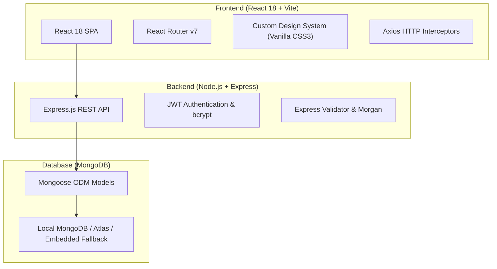

# 🚀 HobbyHub — Next-Gen Forum for Hobbyists & Enthusiasts

> A modernized, hyper-responsive, full-stack online community platform built for creators, makers, tinkerers, and hobby enthusiasts. Powered by **React 18**, **Vite**, **Express.js**, and **MongoDB**.


---

## ✨ Cutting-Edge Features

### 🎨 Next-Generation Modern Design & Aesthetics
- **Glassmorphic UI**: Multi-layered backdrop filters with custom specular highlights and luminous borders.
- **Dynamic Gradient Meshes**: Color-shifting ambient backgrounds tailored per hobby category.
- **Micro-Animations & Smooth Physics**: Built with CSS `@keyframes`, spring curves, and stagger animations.
- **Component-Level Responsiveness**: Adapts smoothly from mobile touchscreens to 4K ultra-wide monitors.
- **Modern Typography**: Precision typographic hierarchy powered by *Inter* and *Space Grotesk*.

### 🗂️ 8 Vibrant Hobby Communities
1. 📸 **Photography** — Gear reviews, composition critique, astrophotography & editing workflows.
2. 🎮 **Gaming** — Competitive strategies, game releases, retro setups & hardware mods.
3. 🎵 **Music** — Home recording, production techniques, synthesizers & beatmaking.
4. 🎨 **Art & Design** — Digital painting, 3D modeling, UI/UX & traditional illustration.
5. 🍳 **Cooking** — Sourdough baking, culinary science, global recipes & knife skills.
6. 💻 **Technology** — Programming in modern languages, self-hosting, open-source & electronics.
7. 💪 **Fitness** — Periodized strength routines, nutrition plans & calisthenics.
8. ✈️ **Travel** — Hidden gems, budget backpacking & off-the-beaten-path itineraries.

### 💬 Rich Discussion Engine
- **Original Posts**: Detailed guides, code blocks, quote formatting, and tag chips.
- **Voting & Karma**: Upvote and downvote system that calculates real-time community reputation.
- **Live Markdown & Preview**: Write tab and instant Live Preview tab for authoring threads.
- **Thread Bookmarks & Sharing**: Instant one-click link sharing with toast feedback.
- **Nested Quotations & Replies**: Reply directly to specific responses with author attribution.

### 🏆 Gamification & Hall of Fame
- **Reputation Ranks**: *Novice*, *Contributor*, *Expert*, *Master*, and *Legend*.
- **Community Badges**: Earn badges for first discussions, milestone upvotes, and helpful answers.
- **Hall of Fame Leaderboard**: Top contributor showcase featuring gold, silver, and bronze podiums.

### 🔍 Omnibox Full-Text Search
- Real-time search across **Discussions**, **Replies**, and **Community Members** with active filter tabs.

### 👤 Interactive Profiles & Customization
- Member profile pages displaying stats, reputation points, badges, discussions, and comment history.
- Built-in avatar customizer with instant SVG presets.

---

## 🛠️ Architecture & Tech Stack



| Layer | Technologies |
|---|---|
| **Frontend** | React 18, Vite 6+, React Router v7, Axios |
| **Styling** | Vanilla CSS3 (Custom Properties, Glassmorphism, CSS Grid, Flexbox, Keyframes) |
| **Backend** | Node.js, Express.js 4, Morgan, CORS, dotenv |
| **Authentication** | JSON Web Tokens (JWT) & bcryptjs salted hashing |
| **Database** | MongoDB with Mongoose ODM (includes embedded in-memory fallback) |
| **Orchestration** | Concurrently for synchronized full-stack dev server |

---

## 📁 Project Structure

```
d:\sd\
├── client/                     # React Frontend
│   ├── public/                 # Static assets & icons
│   ├── src/
│   │   ├── components/         # Navbar, Footer, UI components
│   │   ├── context/            # AuthContext & Session management
│   │   ├── pages/              # Home, Forums, ThreadDetail, CreateThread, Profile, etc.
│   │   ├── services/           # Axios API client
│   │   ├── App.jsx             # Route definitions & scroll manager
│   │   ├── index.css           # Global design tokens, glassmorphism & utilities
│   │   └── main.jsx            # React root entry
│   ├── index.html              # HTML5 entry with Google Fonts
│   ├── package.json
│   └── vite.config.js          # Vite config with React plugin & API proxy
├── server/                     # Express Backend
│   ├── config/                 # DB connection & auto-seed engine
│   ├── controllers/            # Route business logic (auth, forums, threads, posts, search, users)
│   ├── middleware/             # JWT auth middleware, error handler
│   ├── models/                 # Mongoose schemas (User, Forum, Thread, Post)
│   ├── routes/                 # Express REST endpoints
│   ├── seed.js                 # Database seeder with sample community data
│   ├── server.js               # Express application entry point
│   ├── .env                    # Environment configuration
│   └── package.json
├── package.json                # Root orchestration & scripts
└── README.md                   # Documentation
```

---

## 🚦 Getting Started

### 1. Prerequisites
- **Node.js** v18+ installed
- **npm** v9+ installed
- *(Optional)* **MongoDB** running locally on port 27017, or a MongoDB Atlas URI in `server/.env`.
  *(Note: If local MongoDB is not running, the server automatically boots an embedded database engine so you can test immediately!)*

### 2. Quick Launch (Both Frontend & Backend)
From the root directory:

```bash
# Run both Backend API and Vite Frontend simultaneously
npm run dev
```

- **Frontend App**: `http://localhost:5173`
- **Backend API**: `http://localhost:5000/api`
- **API Health Check**: `http://localhost:5000/api/health`

### 3. Individual Services (Alternative)
```bash
# Start backend server only:
npm run server

# Start frontend client only:
npm run client

# Seed or re-seed sample community discussions:
npm run seed
```

---

## 🔑 Test Accounts

You can test using any of the pre-seeded accounts:

| Email | Password | Username | Level | Primary Hobby |
|---|---|---|---|---|
| `dev_priya@example.com` | `password123` | `dev_priya` | Expert | Technology |
| `alex@example.com` | `password123` | `alex_photo` | Contributor | Photography |
| `sarah@example.com` | `password123` | `sarah_gamer` | Contributor | Gaming |
| `emma@example.com` | `password123` | `emma_artist` | Expert | Art & Design |
| `chef_carlos@example.com` | `password123` | `chef_carlos` | Contributor | Cooking |

Or click **Sign Up** on the frontend to create your own unique profile!

---

## 📡 API Reference

| Method | Endpoint | Description | Auth Required |
|---|---|---|---|
| `POST` | `/api/auth/register` | Register new user account | No |
| `POST` | `/api/auth/login` | Login user & return JWT | No |
| `GET` | `/api/auth/me` | Fetch authenticated user details | Yes |
| `GET` | `/api/forums` | Fetch all 8 hobby forum categories | No |
| `GET` | `/api/forums/:id` | Fetch specific forum by ID | No |
| `GET` | `/api/threads` | Filter threads by forum, sort (`latest`, `popular`, `active`) | No |
| `GET` | `/api/threads/:id` | Get thread details & increment view count | No |
| `POST` | `/api/threads` | Create a new discussion thread | Yes |
| `PUT` | `/api/threads/:id/vote` | Upvote or downvote a thread | Yes |
| `GET` | `/api/posts?thread=:id` | Fetch replies for a specific thread | No |
| `POST` | `/api/posts` | Post a reply or quote in a thread | Yes |
| `PUT` | `/api/posts/:id/vote` | Upvote or downvote a reply | Yes |
| `GET` | `/api/users/:id` | Fetch user profile, badges & activity | No |
| `PUT` | `/api/users/:id` | Update profile bio, avatar, or interests | Yes |
| `GET` | `/api/users/leaderboard` | Top 10 reputation leaderboard | No |
| `GET` | `/api/search?q=:query` | Search across threads, posts, and users | No |

---

## 🛡️ License
MIT License. Built for passionates, hobbyists, and the modern web community.
